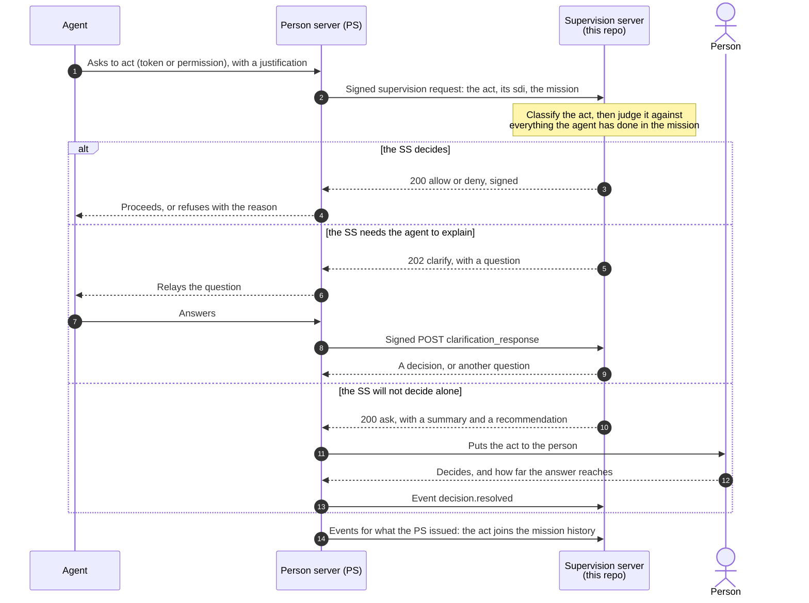
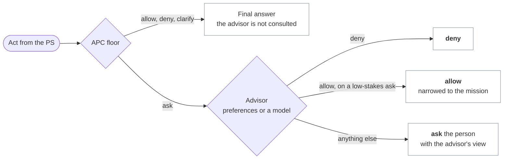
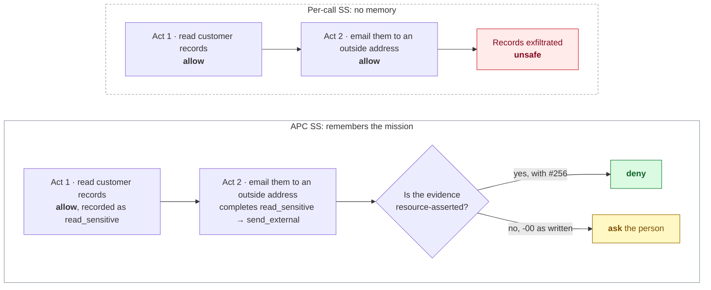

# aauth-supervision-server

[](https://github.com/xmuruaga/aauth-supervision-server/actions/workflows/ci.yml)
[](LICENSE)
[](pyproject.toml)
[](tools/check.py)

An independent Supervision Server (SS) for
[AAuth Supervision -00](https://dickhardt.github.io/AAuth/draft-hardt-aauth-supervision.html),
with a deterministic, composition-aware policy based on the Agentic Principal Chain
(APC) model of [Bounded Agents](https://arxiv.org/abs/2608.15888).

The SS is the party a person server (PS) asks "may this agent do this?" on the person's
behalf. This one answers from the act and from everything the agent has already done in
the same mission (a task the agent proposed and its PS approved). What the agent did in
its other missions counts too, but can only lead the SS to ask the person, never to
refuse on its own. The default policy consults no model, so the same inputs always give
the same answer and every answer has a trace. A model can be layered on top without
loosening what the policy protects (see "A deterministic floor with a model on top").

Status: a research implementation of a draft that is not yet submitted (Supervision -00,
pinned below), for study, interop and conformance work, not for production
(`SECURITY.md`). What it does not cover is under "Limitations". This repository
implements the Supervision Server role; it is independent of, and not endorsed by, the
AAuth draft authors.

## AAuth in brief

[AAuth](https://aauth.dev) is an HTTP authorization protocol for agents, by Dick Hardt,
editor of OAuth 2.0 (RFC 6749). Every agent has its own cryptographic identity and signs each
request with HTTP Message Signatures (RFC 9421), so there is no pre-registration and no
shared secret to leak. A person server (PS) represents the person: identity, consent,
missions and audit. [AAuth Supervision](https://dickhardt.github.io/AAuth/draft-hardt-aauth-supervision.html)
lets the PS hand the decision on each act to a supervision server the person chooses,
which is the role this repository implements.

- [aauth.dev](https://aauth.dev): overview, walkthrough demo and the
  [protocol explorer](https://explorer.aauth.dev)
- [dickhardt/AAuth](https://github.com/dickhardt/AAuth): the drafts, issues for
  specification discussion, and the
  [implementations table](https://github.com/dickhardt/AAuth#implementations)
- The drafts, latest editor's copies (the versions this server is pinned to are under
  "Pinned versions"): the
  [protocol](https://dickhardt.github.io/AAuth/draft-hardt-oauth-aauth-protocol.html),
  [Supervision](https://dickhardt.github.io/AAuth/draft-hardt-aauth-supervision.html),
  [R3](https://dickhardt.github.io/AAuth/draft-hardt-aauth-r3.html) and
  [Budgets](https://dickhardt.github.io/AAuth/draft-hardt-aauth-budgets.html)
- [aauth-dev](https://github.com/aauth-dev): SDKs, demos and community implementations

## How it fits

The agent never talks to the SS. The PS asks on its behalf, and the SS answers in one
of four ways: `allow` or `deny` (it decides), `clarify` (it asks the agent something
first), or `ask` (it hands the act to the person).



Terms used below:

- **Mission**: a task the agent proposes and its PS approves, naming the resources and
  tools it may use. The SS keeps the history of each mission's acts.
- **Act**: what the PS asks about: a person token, an auth token for a resource, or a
  permission to use one of the agent's own tools.
- **`sdi`**: the identifier the PS gives each supervision request. It ties the request to
  the SS's answer, the person's answer and any token issued under it.
- **Composition**: acts harmless alone that the policy forbids together, such as reading
  sensitive records and then mailing them outside (`prohibited_pairs`,
  `prohibited_sequences`). The person is told of "a combination the policy forbids".
- **Certain or uncertain**: whether the SS can rely on what an act is, or only on what
  it may be. It relies on what the resource stated, on what the policy's rules fix, and
  on the agent's own details or report where they make an act more severe: what the
  agent says against itself is taken as said. It is uncertain where a rule needs data
  the request or report does not carry (the class is assumed), or where the agent's own
  details would make the act less severe, which the SS cannot check. A composition on
  certain evidence is denied; on uncertain evidence it is put to the person. What the
  resource stated (resource-asserted, the resource's word) is what the PS forwards in
  the resource token, or in an R3 proposal bound to that token by its `r3_s256`. The SS
  verifies the PS's request signature, not the resource token's own signature, so this
  rests on the PS having verified the token (`SECURITY.md`, "Forwarded tokens").
- **Reach**: how far the person's answer to an `ask` extends: this act only, the rest of
  the mission, from now on, or acts that complete one composition. It covers later acts
  the SS would put to the person again for the same reason, and never refuses an act the
  SS would allow.
- **R3** (Rich Resource Requests) and **Budgets**: companion AAuth drafts. R3 lets a
  resource describe a call's operations and parameters; Budgets lets it offer a spending
  allocation and report what was spent.
- **`L190`, `Protocol L2236`**: lines of the drafts pinned in `specs/` (see "Pinned
  versions").

## Try it

```
python -m venv .venv                 # Python 3.11 to 3.13 (Windows: py -3.12 -m venv .venv)
source .venv/bin/activate            # Git Bash: source .venv/Scripts/activate; PowerShell: .venv\Scripts\activate
pip install -e .
aauth-ss demo                        # watch the SS decide a short mission
aauth-ss demo --extension --trace    # the same mission with the R3 proposal forwarded
```

The demo runs the real server against the simulated PS in one process, with real
signatures and no network: a mission is approved, metered inference runs into an AAuth
Budgets ceiling, which a consumption record for a token still live does not lift (the
token may spend the rest), and a split exfiltration is put to the person (Supervision -00
as written) or denied by the SS itself (`--extension`). `aauth-ss demo --show-policy`
prints the policy it uses.

## What it does

- **The SS side of Supervision -00, with one documented gap and one documented choice.**
  Metadata and JWKS,
  connect (confirmed by an operator on a development page, or accepted for a trusted
  PS's tenant or by configuration; Supervision L244 has the person confirm, and this
  page stands in for that), mission proposal, approved, update, completion and
  terminated, the decision endpoint for `person_token`, `auth_token` and `permission`,
  events, clarification on pending URLs, signed decisions, idempotence, replay and
  recovery, and the error table. Decisions are made within the request: there is no
  deferred decision (see Limitations). The gap: the development confirmation page does
  not rate-limit lookups of unknown interaction codes (Run it). The choice: two rules
  answer a poll from a PS this SS does not accept differently. L188 answers any request
  from such a PS with `unsupported_iss`; L286 requires `unknown_pending` for a poll from
  an identity other than the requester's (Errors, L635). This SS follows L188 (matrix
  row SUP-027, `docs/findings.md` F12).
- **RFC 9421 signatures under the AAuth profile.** It verifies PS requests under the
  `jwks_uri` scheme with Ed25519 or ES256 (the key's JWK `alg` required, polymorphic
  algorithms refused; a signature's `alg` parameter ignored, Protocol L2236) and signs
  its answers with `;req` components. Key discovery follows the Signature-Key egress
  rules: HTTPS only, no private destinations, DNS pinning, no redirects, and one
  deadline over the whole fetch, from name resolution to the body.
- **APC policy.**
  - **Action classes.** Declarative rules map each act to an action class. A domain rule
    (`param_domain_not_in`) reads every recipient a value names, in every parameter the
    rule names: `a@x.example, b@y.example` is two. A parameter the act does not carry
    names nobody. A recipient that is not plainly `local@domain` is outside every listed
    domain. A code rule (`param_in`) matches when each parameter it names carries a value
    in its set, exactly, such as a merchant category code in an offer: a list matches when
    any of its values does, an integer reads as its digits, and a parameter that is absent
    or not a string or integer (an R3 digest object, a float) leaves the rule undecided.
  - **Provenance on every classification.** Evidence is tagged `resource`, `configured`
    or `agent`. An act replayed to this SS keeps the provenance of what the replay
    carries, and is marked as replayed. An act the resource's R3 proposal describes
    (with R3 forwarding on, below) rests on the resource's word for its own class,
    whatever rule classed it, when the proposal is the bytes its resource token binds by
    `r3_s256`. An R3 object sent under a custom `r3_member`, with no `r3_s256` binding,
    is classed the same way but rests on the PS's word. A further class it only
    may have, for data the proposal leaves out, does not rest on that word, and meets
    the high-impact gate as such. Evidence the agent asserts can make a class stricter,
    never looser. It never takes an act out of a composition, a budget or the
    high-impact gate. An act whose class the agent's data raised is also each class it
    has with that data set aside. Each of those is as certain as that class is, with the
    amount that class's rule reads. An act whose class was assumed, for data a rule
    needs and does not have, is likewise each class the rules would give it with that
    data. Each of those is uncertain, and counted with the amount that class's rule
    reads. The same holds for a token replayed to a new SS, which carries no proposal.
    It holds too for an act whose operations a data rule could not read, where the rule
    that classed it names no operation. An act 0.1.x recorded keeps the one class it was
    booked with.
  - **Composition closure.** Prohibited pairs and sequences are checked across
    resources, and across a delegation chain. History is per mission, so acts split
    between a parent agent, a sub-agent and a call chain still compose. Acts an agent
    takes outside any mission compose with its acts inside its missions, in both
    directions. An agent acting under another agent's mission (a call chain) is part of
    that mission's chain on both sides of the boundary. A violation on certain evidence
    is denied; on uncertain evidence it is put to the person. The acts composed are auth
    tokens, permission grants, audit records, and person tokens for a resource the
    policy lists as serving on identity alone (`serves_on_identity`).
  - **Acts that may still take effect.** A sequence is checked whichever of its steps an
    act is, not only the last. An issued auth token can be presented until its `exp`
    (from `auth_token.issued`), and a permission grant has no lifetime. So an act taken
    earlier for a later step can still take effect after the act being decided. An act
    the SS has answered but that is not history yet counts as uncertain, so it can make
    a concurrent act be asked, never denied. Such acts are an ask the person is
    deciding, an open clarification, and an allowed token not yet reported issued.
  - **Across missions, as uncertain.** This SS approves a mission proposal by policy, so
    a second mission is not the person's approval, and a token outlives the end of its
    mission. The acts of the agent's other missions (missions of the same person that an
    agent of its chain owns or has acted in) compose with an act as uncertain. A
    prohibited composition that needs another mission is put to the person, never
    denied. A "no" the person gave to it with reach is applied (Supervision L582).
    Class and resource budgets stay per mission.
  - **Across instances of one provider, as uncertain.** Every agent instance has its own
    identifier (Protocol L167), `aauth:local@domain`, whose domain names its agent
    provider (Protocol L488). Instances of one provider may share what they read. The
    acts of the person's other agents from the provider of an agent in the act's chain
    compose with it as uncertain, as another mission's do: asked, never denied. That
    covers their acts outside missions and in their missions. Agents of other providers,
    and identifiers of any other form, do not compose. Those acts spend none of the act's
    class or resource budgets.
  - **Person tokens where a resource serves on identity.** A resource may serve a
    request on a person token alone (Protocol L326-L346). For a resource in
    `serves_on_identity`, a person token the PS reports issued joins history as an
    uncertain act of each class the policy gives the resource, usable until 60 seconds
    past its `exp`. That includes those the PS issues at mission approval, which are
    booked for the hour a person token may live unless reported with a later `exp`
    (Limitations). Such a token can make a later act be asked, never denied, and spends
    no budget.
  - **Class budgets** (the policy's `budgets`) per mission (outside missions, per
    agent), by count and by amount. An act whose amount the SS never saw is not counted
    as zero: a later act against that budget is put to the person, unless the amounts the
    SS did see already take the budget past its limit with this act's own, or already
    fill it and this act's amount is not visible either; then the act is refused. An
    amount of 0 fits a budget by amount; the count still applies. A ceiling reached only
    through classes acts may have besides their own, assumed for data a rule needs, is
    put to the person (the acts may not be of those classes). The class a rule's
    `if_unknown` makes an act's own counts as that rule says.
  - **AAuth Budgets at metered resources.** A per-mission ceiling in the resource's own
    unit, held against the `budget` offer and the signed `budget_consumed` record the
    resource puts in its resource token. An allocation counts as fully consumed, as
    Budgets requires of an issuer. A consumption record can only raise that figure: it
    "settles nothing" while the token is live (Budgets L841). An offer in another unit
    or scale is never converted: it is put to the person, or refused once the ceiling is
    spent. An offer of 0 in the ceiling's unit and scale fits, since such a grant spends
    nothing (Budgets L344, L913).
  - **What a budget deny says.** It names the budget, never its figures: the agent reads
    a deny's reason (Supervision L265), and the ceiling "may not be shared with the
    agent" (Budgets L218). The figures are in the trace. An ask, which the person
    reads, states the ceiling and the figures the supervisor has: what is offered, what
    is left or counted, and what acts not reported yet may take.
  - **Intent:** acts outside the approved mission are asked.
  - **Reach of the person's answers:** `once`, `mission`, `always`, and per-composition,
    for an `allow` and for a `deny`. An answer given with a reach is applied, within its
    scope, where the SS would put the act to the person again for the same reason: for
    a resource or tool the mission leaves out, in a mission that leaves it out; for a
    high-impact act, wherever it would be asked for that; for a composition, to later
    acts of the same class on the same target that may complete it. A `deny` so given
    never refuses an act the SS would allow. Each option's label says where it applies.
    An answer about a composition covers that composition only, and is offered for the
    rest of a mission only: outside missions such an ask offers this act only. An act
    that completes several is allowed by reach only when every one of them was answered.
    A completion on certain evidence is denied whatever was answered about an uncertain
    one. No remembered answer passes a budget, so a budget ask offers this act only; a
    "yes" lets that act through, though it may take the budget past its limit (see
    Limitations).
- **R3 forwarding (opt-in extension).** When enabled (`r3_member` in the policy) it
  uses the R3 content the PS forwards under that member, in the decision request (the
  change [AAuth #256](https://github.com/dickhardt/AAuth/issues/256) proposes) and in
  `auth_token.issued`: a per-call proposal, or the R3 document an ordinary R3 resource
  token references, as base64url bytes checked against `r3_s256` and used only when the
  resource token carries one (an object under a custom `r3_member` is taken on the PS's
  word, and so is the proposal in a replayed `auth_token.issued`, which has no resource
  token to check it against). A document gives operations but no parameters, and
  digest-object parameters count as not visible. In `auth_token.issued` a per-call
  proposal brings the released `result` that
  [AAuth #257](https://github.com/dickhardt/AAuth/issues/257) asks the PS to report to the
  SS as replayable state. Off by default, so the server is spec-only Supervision -00
  unless you opt in (see Limitations).

## Architecture: the policy is a plug

The protocol layer and the decision model are separate. `SupervisionServer`
(`service.py`) is pure Supervision -00 wire logic: it parses and verifies the signed
request, builds a normalized act, keeps the mission, history and reach state, signs the
answer, and handles idempotence and replay. It never reaches into *how* a decision is
made. The decision model is injected and reached only through the `SupervisionPolicy`
interface (`policy.py`): four methods (`classify`, `decide`, `decide_proposal`,
`serves_on_identity`) and two attributes (`r3_member`, `ask_on_mission_update`).

The APC policy in this repo is one implementation of that interface. Any object with the
same shape can replace it without touching the protocol layer: a flat allow-list, a rule
engine, or an adapter to a language model that answers while the PS waits (the SS has no
deferred decision, see Limitations). `tests/test_pluggable_policy.py` shows this by
driving the unmodified server end-to-end, through the real signed-request path, with a
deliberately trivial non-APC policy, and checks that both the APC `Policy` and the
trivial one satisfy the `@runtime_checkable` interface. `aauth-ss serve` runs the APC
policy from a JSON file; to serve another policy, build `SupervisionServer` with it in
Python, as the docstring of `examples/layered_policy.py` shows.

### A deterministic floor with a model on top

`examples/layered_policy.py` combines the two kinds of judgment the draft names, rules
and "a model applying the person's preferences", behind the same interface. The APC
policy decides first and its `allow`, `deny` and `clarify` are final. Only when it
would put the act to the person does an advisor speak:



What the advisor may do is asymmetric, because what it reads is agent-asserted:

| The advisor answers | Effect on the floor's `ask` |
|---|---|
| `deny` | Applies: refusing on the person's behalf can only make the SS stricter |
| `allow` | Applies only to a low-stakes ask: no prohibited composition, no unchecked budget, not high-impact, a certain class. Otherwise the person still decides |
| `ask` | The floor's `ask` stands, with the advisor's rationale added to the `summary` |
| An `allow` the floor does not let it apply | The floor's `ask` stands; the trace records the advice |
| An error, a timeout, anything malformed | The floor's `ask` stands unchanged; the trace records that the advisor was unavailable |

Two advisors are included: `PreferenceAdvisor`, standing preferences the person wrote,
and `ModelAdvisor`, any language model behind a `complete(prompt) -> str` function you
supply, with a strict JSON answer, the agent's text fenced as untrusted, and a time bound
(5 seconds by default) past which the person decides.
`tests/test_layered_policy.py` pins the contract, including a model that a prompt
injection has turned into "allow everything", a property test over arbitrary floor
answers and advice, and a run through the unmodified signed server.

## Results

- `docs/conformance-matrix.md` is generated from the pinned drafts. It covers 189 BCP 14
  keyword rows from Supervision -00, R3, the core (including the sections Supervision
  incorporates by reference for the SS's answers, and those the SS meets as the verifier
  of every PS request) and Budgets, plus 17 SS behaviours the draft states or implies in
  prose (marked `prose`, so no keyword is attributed to the draft): 153 tested, 50 n/a
  (each with its reason, most because it binds another role), 1 gap (not met,
  documented: the development confirmation page does not rate-limit lookups of unknown
  codes), 2 open, both MAYs this SS does not take: `options` in a clarification
  (REF-004) and `accept_signature_algs` in its metadata (REF-022). Every tested row
  names its tests, and seven add a note where this SS does less or more than the row's
  sentence. HTTP Signature Keys -09, whose verifier rules apply to every request, is not
  in the matrix: its tests are `tests/test_signatures.py`,
  `tests/test_hardening_signatures_egress.py` and `tests/test_resolver_hardening.py`,
  and where this SS departs from it is under Limitations (keys and cache headers).
- `docs/adversarial-results.md` gives the critical-act decision in ten attack
  scenarios under four configurations.

The core case is T2. Each act is harmless alone; together they exfiltrate data. Only a
supervisor that remembers the mission sees it, and how firmly it can act depends on
what the wire lets it verify:



All ten scenarios:

| Configuration | correct | escalated to the person | unsafe |
|---|---|---|---|
| per-call SS (a baseline: no composition, sees the proposal) | 3 | 0 | 7 |
| APC, Supervision -00 as written | 3 | 7 | 0 |
| APC, proposal forwarded in `auth_token` ([#256](https://github.com/dickhardt/AAuth/issues/256)) | 9 | 1 | 0 |
| APC, proposal also in `auth_token.issued` ([#257](https://github.com/dickhardt/AAuth/issues/257)) | 10 | 0 | 0 |

How to read it:

- The per-call SS is a baseline, not a reading of the draft and not a separate design:
  it is this engine with the same rules and the same visibility of the proposal, and
  only composition and budgets removed.
- A memoryless SS is unsafe: an agent can split an exfiltration into acts that are each
  fine alone, and spend past a ceiling one allocation at a time.
- APC on today's wire is safe but mostly cannot decide. The resource token gives the SS
  the resource, the scope and any budget (Supervision L504), but the call's parameters
  (a recipient, an amount) come only from what the agent claims, since the SS never sees
  the R3 proposal the PS renders for consent (R3 L676). So it puts the act to the person,
  with a summary that rests on that claim for them. The exception is metered spend
  (T10): AAuth Budgets puts the resource's offer and its signed consumption record in the
  resource token, so the SS can hold a ceiling with no change to the wire.
- Forwarding the proposal lets the SS decide. The remaining case, T9, is a routing change
  after a sensitive result was released. It needs the proposal in the issuance event as
  well, so it survives replay to a new SS.
- Every scenario runs inside one mission. The same exfiltration split
  across two missions, or read on a person token at a resource listed as serving on
  identity, is put to the person, never denied (`tests/test_cross_mission.py`,
  `tests/test_identity_access.py`).

## Spec feedback

Implementing the SS surfaced four questions in the drafts, filed upstream:

| Issue | Question | Finding |
|---|---|---|
| [dickhardt/AAuth#256](https://github.com/dickhardt/AAuth/issues/256) | The R3 per-call proposal does not reach the SS | F1 |
| [dickhardt/AAuth#257](https://github.com/dickhardt/AAuth/issues/257) | A released `result` does not reach later decisions or a replacement SS | F2 |
| [dickhardt/AAuth#258](https://github.com/dickhardt/AAuth/issues/258) | The "same signed response" on a retry goes stale under a freshness window; an `sdi` reused for a different request | F6, F3 |
| [dickhardt/AAuth#259](https://github.com/dickhardt/AAuth/issues/259) | An SS `allow` cannot size a Budgets allocation (nor an R3 grant) | F8 |

Each finding in `docs/findings.md` gives the draft text, the effect, what this SS does
about it, and the tests that show it. The rest of that file records implementation
choices where the draft leaves room, and questions not filed yet (F9 to F17).

## Run it

```
python -m venv .venv                 # Python 3.11 to 3.13 (Windows: py -3.12 -m venv .venv)
source .venv/bin/activate            # Git Bash: source .venv/Scripts/activate; PowerShell: .venv\Scripts\activate
pip install -e .

aauth-ss keygen --kid ss-2026-10 --out keys/ss-key.json
aauth-ss check-policy examples/policy.json
aauth-ss explain examples/policy.json --resource https://mail.example --scope mail.send
export AAUTH_SS_ADMIN_TOKEN="$(python -c 'import secrets; print(secrets.token_urlsafe(32))')"
aauth-ss serve --config examples/server.json --policy examples/policy.json --key keys/ss-key.json --state state/ss.json --port 8443
```

In PowerShell, set the operator token with
`$env:AAUTH_SS_ADMIN_TOKEN = python -c "import secrets; print(secrets.token_urlsafe(32))"`.
The environment variable, when set and not empty, wins over `admin_token` in the server
file. On Windows, if script activation is blocked, skip it and call the venv's programs
by path: `.venv\Scripts\python -m pip install -e .`, then `.venv\Scripts\aauth-ss`, and
`.venv\Scripts\python` for `pytest` and `tools/`.

`examples/policy.json` turns on the R3 forwarding extension
(`"r3_member": "r3_proposal"`; see "Extensions to the draft" under Limitations). To run
spec-only Supervision -00, serve a copy of it without the `r3_member` line: the SS then
ignores the member.

To develop:

```
pip install -e ".[dev]"
(cd interop/aauth-go && go mod download)   # once, for the aauth-go interop tests (Go 1.26+)
pytest -q                            # the full suite
python tools/check.py                # every merge gate, offline (see Quality)
python tools/check.py --fast         # the same gates without the coverage run
python tools/extract_matrix.py       # regenerate the conformance matrix (--check to verify)
python tools/run_adversarial.py      # regenerate the adversarial results (--check to verify)
```

`serve` binds a loopback address only and refuses any other, and prints the address it
bound (with `--port 0`, the port the system picked; an IPv6 host in brackets). Check it
with `curl http://127.0.0.1:8443/.well-known/aauth-supervisor.json`, and stop it with
Ctrl+C. Keep
`keys/` and `state/` private to the SS's user: the key is the SS's signing key, and the
snapshot holds forwarded token claims and mission text. On POSIX both files are created
owner-only; on Windows they inherit the directory's ACL. Put a TLS-terminating reverse
proxy for the `issuer` origin in front of it, and have it pass the original `Host`
header through: the PS signs `@authority`, and the SS checks it. Have it buffer each
request whole and limit connections per client too: the listener serves at most 64
connections at once, each request must arrive whole within 10 seconds, and behind the
proxy it cannot tell one client from another. Under open registration the SS counts the
names made under one domain as one when it makes room at its caps and in its key table
(under a listed public suffix, such as `co.uk` or a hosting service's `github.io`, each
site is a domain of its own), but someone holding many registered domains, or many sites
at a hosting service, each serving a metadata document, can still churn the connects
awaiting confirmation and the key table; limits per client at the proxy are what stop
that.

The connect confirmation page (`/interaction`) is protected by an operator token
(`admin_token` in the config, or `AAUTH_SS_ADMIN_TOKEN`); without one, a connect that
waits on the page can never be confirmed, and `serve` warns at start. A wrong token
counts against the connect whose code it was posted with: after five, that connect
fails for good (its code is `invalid_code`, and its PS is told `denied`), so guessing
the token costs a live code every five tries, and no one can stop the operator
confirming the other connects. Under open registration a connect failed so still counts
against its signer's share (64) and the cap on all such connects (1,024) until its
record is removed, an hour after it would have expired, so a signer cannot open new
connects and guess without end. The page is a development stand-in for a real
person-facing confirmation with the person's own authentication: it does not
rate-limit lookups of unknown codes, which the core's Interaction Code Format asks of
the host of an interaction URL (Protocol L2398).
A connect awaiting confirmation expires after an hour (this SS's choice), and its code
with it (Protocol L2400).

To connect a PS, give it this SS's `issuer` (Supervision L157): the PS reads the SS's
metadata at `<issuer>/.well-known/aauth-supervisor.json` and its keys at
`<issuer>/.well-known/jwks.json`, through your proxy. Name the PS under `trusted_ps`, or
a request from it gets `unsupported_iss`. A connect that needs confirming is answered
with an interaction URL and code (`/interaction?code=...`), which the PS hands on; on
this development page the operator checks the code and the PS it names, and confirms
with the operator token. `GET /health` answers `{"status": "ok"}` for a load balancer.

What a PS integrating with this SS should know:

- **Verify a decision without a freshness window.** Check its signature, the `id` in
  its `Signature-Key` and its `sdi`, but not how old its `created` is: a retried request
  gets the original signed response, `created` included (Supervision L316;
  `docs/findings.md` F6, [AAuth #258](https://github.com/dickhardt/AAuth/issues/258)).
- **Retry with the same JSON body.** The members may come in any order, but a change to
  any value makes it a different request under that `sdi`, which is refused with
  `invalid_request`. Only `iat` written as another spelling of the same whole number
  (`1790600000.0` for `1790600000`) is taken as the same.
- **A clarification's decision is the answer to the POST to the pending URL.** After
  that answer the pending URL answers `410 Gone`. If the answer is lost, resend the
  original request under its `sdi`: it gets the same decision.
- **Publish the PS key with `alg` `Ed25519` or `ES256`.** A key without `alg`, or with
  the polymorphic `EdDSA`, is refused (Protocol L2280, L2171), and so is one whose `use` is not
  `sig` or whose `key_ops` leaves out `verify`.
- **Send each body with `Content-Length`.** A chunked body (`Transfer-Encoding`) is
  refused with `411`, so the reverse proxy in front of the SS must send one too.
- **A poll from a PS this SS does not accept gets `unsupported_iss`** (403), not
  `unknown_pending` (`docs/findings.md` F12).

To try a real PS on your own machine: the SS fetches the PS's metadata from
`https://<its issuer host>/.well-known/aauth-person.json` (port 443) and its JWKS from
there, over TLS checked against the CA certificates Python loads by default
(`SSL_CERT_FILE` changes the file it reads), and refuses private and loopback addresses
unless the host name is listed in `egress.allow_private_hosts`.

## Configuration

`aauth-ss serve` reads two JSON files; `aauth-ss check-policy` checks the second. A
misspelt or mistyped member is an error. `examples/server.json` and
`examples/policy.json` are complete examples; members they leave out take the defaults
below.

The server file (`--config`):

| Member | Meaning (default) |
|---|---|
| `issuer` | This SS's own server identifier: `https://` and a lowercase host, with no port or path (required) |
| `name` | The display name in its metadata ("AAuth APC Supervisor") |
| `trusted_ps` | The PSes it accepts, by issuer: `auto_connect` connects their people without the confirmation page (false); `tenants` lists tenants whose people connect without it ([]) |
| `open_registration` | Accept any PS, each connect confirmed on the page (false) |
| `signature_window` | Seconds a signature's `created` may differ from this SS's clock (60, at most a day) |
| `transit_allowance` | Seconds the fastest of a PS's requests may take to arrive (2, at most a day; see Limitations) |
| `rate_limit_per_minute` | Requests per minute from one PS, across its people (0: no limit) |
| `clarification_rounds`, `clarification_timeout` | Questions to the agent per request (3), and seconds each waits for its answer (120, at most a day) |
| `admin_token` | The operator token of the confirmation page (none; `AAUTH_SS_ADMIN_TOKEN`, when set and not empty, wins over it) |
| `documentation_uri` | An https URL published in its metadata (none) |
| `egress` | Key discovery: `timeout` per fetch (5 s), `max_bytes` per document (262144), `allow_private_hosts` ([]), `allow_cross_origin_jwks` (false) |

The policy file (`--policy`):

| Member | Meaning (default) |
|---|---|
| `severity` | The classes, least severe first (required: every class the policy names, `default_class` included) |
| `rules` | In order: each names a `class`, what it matches (`resource`, `operation`, `scope`, `tool`, glob patterns as Python's `fnmatch.fnmatchcase` reads them: `*`, `?`, `[...]` and `[!...]`, case-sensitively; `[[]` matches a literal `[`) and, for a data rule, what it reads (`param_domain_not_in`, `param_gt`, `param_in`, `result_contains_any`), with `amount_param` (the parameter a budget counts) and `if_unknown` (the class to take when the data is not there) |
| `default_class` | The class of an act no rule names (`unclassified`) |
| `prohibited_pairs`, `prohibited_sequences` | Compositions of classes the SS will not let complete |
| `composition_on_certain` | What a composition on certain evidence gets: `deny` (default) or `ask` |
| `high_impact` | Classes that need resource-asserted evidence, or the person |
| `budgets` | Per class: `max_count` and `max_amount` per mission (outside missions, per agent) |
| `resource_budgets` | AAuth Budgets ceilings per resource: `unit`, `decimals`, `max_amount` |
| `deny_resources` | Resources refused outright (glob patterns) |
| `allowed_tools`, `ask_tools` | Tools (glob patterns) a mission proposal may be approved with (["*"]), and those put to the person ([]) |
| `allow_unlisted_resources` | Inside a mission, act at resources it did not name without asking (false); outside missions every resource is open, so see Limitations |
| `clarify_missing_justification` | Ask the agent why before putting a high-impact act with no justification to the person (false) |
| `max_mission_seconds` | Cap a mission's life at approval (none) |
| `ask_on_mission_update` | Put an agent-reported mission change to the person (false) |
| `serves_on_identity` | Resources that may serve a request on a person token alone (glob patterns; []) |
| `r3_member` | The request member that carries a forwarded R3 proposal, a non-spec extension (AAuth #256; none) |


## Quality

`tools/check.py` is the merge gate, and CI (`.github/workflows/ci.yml`) runs the same
script on Linux, macOS and Windows with Python 3.11 to 3.13, and on 3.14 as a preview
that cannot fail the run (3.14 joins the supported versions once the gate passes on all
three). Once dependencies are
installed it needs no network and no running second implementation:

| Gate | What it enforces |
|---|---|
| ruff, mypy | Lint, and typed `src/` (mypy with `disallow_untyped_defs`) |
| pytest under branch coverage | The deterministic suite, with 100% line and branch coverage of `src/` (`fail_under = 100`, no inline `pragma: no cover`) |
| properties | The Hypothesis property tests, kept out of the coverage measure; the few Hypothesis tests inside it run derandomized, so 100% never depends on a random draw |
| conformance matrix | `docs/conformance-matrix.md` is regenerated from the pinned drafts and must match |
| adversarial results | `docs/adversarial-results.md` is re-run and must match |

The suite is layered:

- **Conformance.** Every tested matrix row names its tests (`@pytest.mark.req`).
- **Standard vectors.** RFC 9421 Appendix B signatures are reproduced or verified
  byte for byte (`tests/test_rfc9421_vectors.py`).
- **Independent implementations, in two languages.** Requests signed by
  [regent-httpsig](https://github.com/regent-protocol/regent-httpsig) (Python, from the
  AAuth README's implementations table) and by
  [aauth-go](https://github.com/aauth-dev/aauth-go) (Go, the SDK aauth.dev lists,
  v0.2.0, draft -11) verify here, and requests this code signs verify with both. So
  the independent libraries check this SS's handling of request signatures; the
  responses it signs are checked only by this project's own code (`verify_response` in
  `httpsig.py`, which the simulated PS in `testing.py` calls). With aauth-go the check
  goes further: two whole missions run against the unmodified server with every PS
  request signed by aauth-go. The first ends in the split exfiltration
  denied with the R3 proposal forwarded (the opt-in AAuth #256 extension; under
  Supervision -00 as written the same act is put to the person). The second, under -00
  as written, denies a prohibited sequence whose tokens are taken in reverse order
  (`tests/test_interop_regent_httpsig.py`, `tests/test_interop_aauth_go.py`,
  `docs/interop.md`).
- **Fuzzing and properties.** Signature headers, structured fields, snapshots and the
  service state machine are fuzzed. Hypothesis checks the parser invariants
  (`tests/test_properties.py`).
- **Model-based lifecycle.** A Hypothesis state machine drives the real server with
  random sequences of requests, answers, polls, withdrawals, retries, resolutions and
  clock ticks, and checks every answer and stored decision against a small model
  (`tests/test_properties_lifecycle.py`). Re-introducing either of two known lifecycle
  defects (those behind matrix rows SUP-P15 and SUP-P17) makes it fail with a three-step
  counterexample.
- **No pair unseen.** A second state machine interleaves requests for both halves of a
  prohibited pair with the person's answers, issuance reports in any order and the
  clock, and checks that every pair that ends up issued was put to the person, and that
  a deny always rests on an issued act (`tests/test_properties_open_acts.py`). A third
  adds new missions, acts outside missions and person tokens at a resource that serves
  on identity, and checks every answer against a model of the rule: a deny only on
  certain evidence in the act's own scope, an ask for evidence from another mission or a
  person token (`tests/test_properties_cross_mission.py`).
- **Engine semantics.** Each policy rule is pinned at its boundary, so a scenario that
  happens to still pass cannot hide a regression (`tests/test_policy_semantics.py`).
- **Mutation testing.** `policy.py`, `httpsig.py` and `service.py` are mutated with
  mutmut, and, with targeted mutants, the lines 0.2.0 added up to the last of those runs
  (905 targeted mutants);
  every surviving mutant is either killed by a test or recorded as equivalent, with the
  reason, but for 10 that targeted code since removed or simplified
  (`docs/mutation-testing.md`). Later changes (among them how acts are placed in
  time against a token's end, the order of late reports and replays, and the classes an
  act may have where data a rule needs is missing) were not mutated: each began with a
  test that failed before it, under the same coverage gate.

## Layout

| Path | What |
|---|---|
| `src/aauth_supervision_server/service.py` | Protocol logic: one `handle(request) -> response`, no sockets |
| `src/aauth_supervision_server/policy.py` | The APC policy engine |
| `src/aauth_supervision_server/markdown.py` | Text the SS did not write, quoted inside the Markdown the person is shown |
| `src/aauth_supervision_server/httpsig.py`, `sfv.py`, `jwk.py` | RFC 9421, RFC 9651 structured fields, JWK algorithm determination |
| `src/aauth_supervision_server/resolver.py`, `egress.py` | `jwks_uri` key discovery under egress admission |
| `src/aauth_supervision_server/store.py` | State, with a versioned JSON snapshot; an unreadable snapshot is set aside (PS replay rebuilds part of it, see Limitations) |
| `src/aauth_supervision_server/http_server.py`, `cli.py` | Loopback listener and the `aauth-ss` command |
| `src/aauth_supervision_server/testing.py` | A simulated PS that speaks Supervision -00, with real signatures and tokens |
| `src/aauth_supervision_server/adversarial.py` | The T1-T10 scenarios |
| `src/aauth_supervision_server/demo.py` | `aauth-ss demo`: a narrated mission against the real server |
| `src/aauth_supervision_server/errors.py` | Signature-key and AAuth protocol errors, rendered as HTTP responses |
| `tests/` | The suite (see Quality); `conftest.py` holds the shared fixtures |
| `specs/` | The drafts the implementation is pinned to |
| `examples/` | A server config and an APC policy, and `layered_policy.py` (the floor with an advisor) |
| `docs/` | Conformance matrix, adversarial results, findings, interoperability, mutation testing |
| `tools/` | `check.py` (the offline gate), matrix and adversarial generators, `mutation_recheck.py` |
| `setup.cfg`, `mutmut_config.py` | Mutation-testing configuration (`docs/mutation-testing.md`) |
| `interop/aauth-go/` | A thin Go command over aauth-go's signer and verifier, driven by `tests/test_interop_aauth_go.py` |
| `.github/workflows/ci.yml` | The same gate on Linux, macOS and Windows, Python 3.11 to 3.13 (3.14 as a preview) |

## Pinned versions

The drafts are taken from the AAuth repository at
[`70d67375deb0bb002af7da0711fc58f6e8926e7e`](https://github.com/dickhardt/AAuth/tree/70d67375deb0bb002af7da0711fc58f6e8926e7e):
Supervision -00, R3, Budgets, the protocol editor's copy and Events, plus HTTP Signature
Keys -09. The AAuth repository lists Supervision as "Exploration, not yet submitted"; it
will change. Line numbers cited here (`L190`, `Protocol L2236`) are lines of these copies
in `specs/`; a bare `L123` is a line of the draft the sentence names, Supervision when it
names none.

## Limitations

- **No second Supervision implementation tested against.** No public PS speaks
  Supervision -00 yet (`docs/interop.md`). The request-signature layer is cross-tested
  with two independent libraries, in Python and Go, and aauth-go signs every PS request
  of two full missions. The SS's signed responses are verified only by this project's
  own code. The Supervision logic of the PS side is still this project's own
  simulated PS. So Supervision interoperability is claimed against one reading of the
  draft.
- **Extensions to the draft.** Forwarding R3 content is not in Supervision -00. That
  content is a per-call proposal, or the R3 document an ordinary R3 resource token
  references, sent under the member the policy's `r3_member` names, in the decision
  request, as [AAuth #256](https://github.com/dickhardt/AAuth/issues/256) proposes, and
  in `auth_token.issued`. There a per-call proposal brings the released `result` that
  [AAuth #257](https://github.com/dickhardt/AAuth/issues/257) asks the PS to report to the
  SS as replayable state. It is **off by default**: with no `r3_member` in the policy the
  server is spec-only and ignores the member. `examples/policy.json` opts in
  (`"r3_member": "r3_proposal"`, a name of this SS's) to demonstrate it. Everything works
  without it, more conservatively.
- **Budgets: the SS can hold a ceiling but cannot size an allocation.** An offer that
  would cross the ceiling is put to the person with the headroom stated, rather than
  granted in part, and a "yes" lets that act take the ceiling past its limit. A request
  whose spend the SS cannot compare with the ceiling (no `budget`, one in another unit or
  scale, or an earlier act there with none in the ceiling's unit) is put to the person
  too. Once the ceiling is spent, such a request is refused, as an offer is; an offer of
  0 in the ceiling's unit and scale still fits. Budgets puts the sizing decision with the
  PS ("Sizing the allocation is where the PS's supervision happens", Budgets L485), and
  with an SS configured the PS "makes no supervision decision of its own" (Supervision
  L79). But a Supervision -00 `allow` can narrow only `scope` and `exp`, and a `deny`
  carries no `suggested_budget`
  ([AAuth #259](https://github.com/dickhardt/AAuth/issues/259)). The SS also assumes the
  PS granted the resource's whole offer, since `auth_token.issued` does not say what was
  granted. It cannot read the resource's usage counters, because it calls no one. Acts
  replayed to a new SS carry no budget, so every later act in that mission at a metered
  resource they used, other than an offer of 0 in the ceiling's unit and scale, is put to
  the person until what the new SS books there since fills the ceiling, and refused
  after that. An allocation the SS allowed but whose issuance
  is not reported yet books nothing. But a later offer that would take the ceiling past
  its limit once that allocation is issued is put to the person, never denied (Budgets,
  Concurrency: the per-token budgets SHOULD sum within the ceiling). An allow never
  reported issued stops counting once the `exp` cap it carries has passed (see "How long
  an open act counts").
- **One process, and nothing is evicted.** State is in memory with a JSON snapshot
  behind one lock. Missions, decisions and events are kept for the life of the state
  file: the draft requires keeping a decision at least until the tokens it allowed
  expire, and allows longer. That is enough for conformance and interop work, but it is
  not a datastore. Every request that changes state writes the whole snapshot, under the
  same lock, and every other request waits for it. Measured on a laptop, that takes
  about 0.3 s for 4,000 acts (an 8 MiB snapshot) and 1.5 s for 20,000 (42 MiB). A
  request that changes nothing (a poll, a repeated event or decision) writes nothing,
  unless it shows the PS's clocks further ahead than any request before it (see "What
  the SS assumes about clocks").
- **A decision costs more as the agent's history grows.** A decision composes over the
  agent's whole history and runs under the store lock. So its cost grows with the
  history, not with how many missions it is split across. Measured on a laptop, it takes
  about 50 ms for 4,000 acts and 0.3 to 0.5 s for 20,000, in one mission or in hundreds.
  `tests/test_cross_mission_scale.py` checks that a history split over 400 missions
  costs no more than three times the same history in one, plus 50 ms. An act outside
  missions is composed again with each of its agent's missions that holds a certain act
  of a class it could complete. That work is capped at twice the work of its history;
  the cap is never below 20,000 acts, and each mission's pass counts as 100 acts more.
  Past the cap, a composition still short of certain is asked as unsettled, as when a
  search runs out of steps. The same test file checks 200 missions over 2,000 acts
  outside them. The person's other instances are found through an index of the agent
  keys, each read once as it is added, not every person's keys on each decision
  (`tests/test_agent_provider.py`).
- **Order is judged by what could happen, not what did.** The SS sees issuance, never
  use. So a live token for a later step of a prohibited sequence makes an earlier step a
  violation, even if the agent never presents that token again. A permission grant has
  no lifetime at all, so one for a later step does so for good. So does a token whose
  `exp` the PS did not report. An audit record may have happened anywhere before its
  report. A token replayed after a routing change may have been used anywhere before its
  `exp`. This SS narrows an `allow`'s `exp` to the mission's `expires_at` and, for an
  auth token or a person token it decides as an act (at a resource in
  `serves_on_identity`), to an hour after the decision (see "How long an open act
  counts"). It
  treats a token as usable until 60 seconds past its `exp` (see "What the SS assumes
  about clocks").
- **Acts not in history yet compose only as uncertain.** An act the SS has answered that
  is not history yet counts as an uncertain act. The cost is more asks when requests
  overlap. Such acts are an act the person is still deciding, one the agent is still
  clarifying, and an auth token allowed whose `auth_token.issued` has not arrived. They
  count because Supervision L211 lets a concurrent request of the same chain arrive in
  between. Each can turn a later act it composes with into an `ask`, never a `deny`, and
  spends no budget. A person's earlier "no" to a composition that only an open act
  completes is put to them again rather than applied. An allowed token counts from the
  answer that allowed it, the others from now on (see "An allowed token counts from the
  answer, an open question from now on").
- **How long an open act counts.** An auth token this SS allows (or a person token it
  decides as an act) counts as open until an hour after the decision, plus the
  60-second margin (see "What the SS assumes about clocks"). An ask counts until `decision.resolved` settles it, since the person may
  answer days later. In a mission an ask also stops counting at the mission's
  `expires_at`, plus the margin: past it the PS treats the mission as terminated and
  caps its tokens there (Protocol L1425). A PS that drops an ask outside any mission
  without reporting `abandoned` leaves later acts that compose with it asked, with no
  time limit. The hour comes from a cap: this SS puts an `exp` on every auth token it
  allows, and on every person token it decides as an act, no later than an hour after
  the decision (Supervision L485 for a person token). Supervision lets an allow narrow
  `exp` and has the PS apply it (L508), and an auth token lives at most an hour anyway
  (Protocol L1775). So a token a PS issues after the cap and the margin is already
  spent. When the PS does issue it after the cap, its `auth_token.issued` reports an
  `exp` not after the event's `iat`, which is the time of the act (Supervision L198). An
  `exp` from the decision to the cap is read as the cap applied, so the token is
  recorded as spent. Any other `exp` not after the `iat` (a lifetime sent as `exp`, a
  slip) is still read as never expiring. Two cases stay outside the cap. One is a PS
  federating with an AS that does not accept the narrowed `exp` (L508 leaves that to the
  AS). The other is an ask the person allowed, after which the SS sends nothing that
  could carry a cap. Its token counts for an hour from the answer, and a PS that issues
  later than that is outside what the SS accounts for until the event arrives.
- **An allowed token counts from the answer, an open question from now on.** A token the
  SS allowed, or the person allowed, may be issued at any moment from that answer. So
  until its issuance is reported, it counts from the answer on, even before acts
  reported since: a PS that reports out of the order Supervision L211 asks for cannot
  slip one in. An act still before the person counts from now on instead. Its token
  cannot be issued before the person's answer, which the PS delivers in order (L211). A
  PS that delivers a later act's event before that answer can get an act allowed in
  between. Once the answer arrives, its token is taken as usable from the question on.
  Where a token reported out of order is placed is set out in "How acts reported out of
  order are placed".
- **What the SS assumes about clocks.** The SS relies on the clocks below: those of
  resources, which judge a token's `exp`, and those of the PS, whose stamps place its
  acts. Each case below comes with what it costs. The PS's *stamp* on an act is the
  `iat` it puts on the request or event for that act: the time of the act at the PS
  (Supervision L198). Any JSON number of at most 2^53 - 1 either way is accepted. The SS
  reads it as the whole second it falls in, so `1790600000.9` is `1790600000`, and keeps
  it so. A retried request repeats its `iat`: one that differs, even below the second,
  reuses the `sdi` for another request (the same whole number written another way,
  `1790600000.0` for `1790600000`, does not differ). The PS's *lead* is how far its
  clocks run ahead of the SS's clock. The SS reads the lead from the PS's requests,
  since the protocol gives it no round trip to measure (see "How acts are placed against
  a token's end").
  - **Resource clocks no more than 60 seconds behind.** A resource judges `exp` by its
    own clock with no tolerance (Protocol L2317). So the SS treats a token as usable for
    60 seconds past its `exp`. A resource more than that behind is outside what the SS
    accounts for.
  - **One PS request within `transit_allowance`.** The server setting
    `transit_allowance` (2 s by default) is how long the fastest of the PS's requests
    may take to reach the SS; a relay or a queue needs a larger one. A PS clock behind
    or ahead then neither stretches nor shortens a token's life, however slow any one
    report is. That holds as long as one of the PS's requests reaches the SS within the
    allowance after its clock last moved forward. A PS whose every request takes longer
    is outside what the SS accounts for. So is one whose clocks move forward and are
    then reached only through slower requests. An act in the seconds before a token's
    end could then be taken as after it.
  - **PS clocks within the signature window.** An act stamped outside the window (as
    during an outage the clock itself caused) can be ordered or placed wrongly. A
    composition through it can then be allowed, or one that does not complete denied.
  - **PS clocks that do not step back while acts are in flight.** A clock stepped back
    can have its acts ordered or placed wrongly, at the same cost. A clock that moves
    back is also read at its earlier lead for as long as the state is kept, since the
    most seen is never lowered: more asks, never fewer.
  - **One clock, or clocks kept together, across a PS's hosts.** A PS that runs on
    several hosts stamps and signs on several clocks. Keep them within about a second of
    each other, none stepping back. Otherwise its acts may be misplaced both ways: a
    composition through them can be allowed, or one that does not complete denied.
  - **Stamps on the clock the PS signs with.** A PS that stamps on a clock behind the
    one it signs with can have its acts ordered or placed wrongly, at the same cost.
  - **A PS clock that moves forward between an act and its report.** A report signed
    after the PS's clock moved forward, of an act stamped before, moves that stamp by
    the new offset. On certain evidence the act is then taken as earlier than it was, so
    a composition through it can be denied as completing where it does not.
  - **A PS clock behind, with acts 0.1.x decided.** Acts are ordered by the PS's own
    stamps, never against the SS's clock, except acts 0.1.x recorded from its own
    decisions, for which it kept only the SS's time of the decision (for an audit record
    or a replayed token it kept the PS's stamp). With the PS clock behind, a token 0.1.x
    decided and reported issued after the upgrade can be taken as reported late.
- **A routing change loses what the events do not carry.** Replay (Supervision L619)
  brings missions, their logs and outstanding tokens. It does not bring the reach of
  earlier answers (the later acts a person's answer covers, through `mission`, `always`
  or a composition), since a replayed `decision.resolved` names an `sdi` the new SS
  never decided. Nor does it bring permission grants (no event reports one), or acts
  outside missions that are not outstanding tokens. A snapshot the SS cannot read is set
  aside, with the same loss plus connections. A replayed token whose stamp agrees with
  the order it arrives in stands there. So a mission log replayed in order is judged as
  the old SS judged it, except for acts within about a minute of a token's end. The new
  SS asks about those, since the PS's clock at the acts is not known to it. A replayed
  token whose stamp does not agree may have been used anywhere its stamp allows: an
  outstanding token replayed after the logs, or two acts stamped in the same second. So
  the new SS can ask where the old one decided. Such an ask is never covered by an
  earlier answer about a sequence that only "may" complete, and offers no reach beyond
  the act.
- **Across missions, the SS can only ask.** This SS answers a mission proposal by
  policy, without the person, unless the proposal names a tool in `ask_tools`, and it
  allows every completion. So a composition split across two of an agent's missions is
  put to the person rather than decided. The other mission's acts count as uncertain,
  since this SS cannot tell whether they took effect together. The cost is more asks for
  an agent that works on sensitive data in one mission and sends in another. When the
  person answers with the `mission` reach the ask offers, there is one ask per later
  mission and composition. An agent that read sensitive records in one mission and sent
  internal mail in five later ones was asked once in each. When the person answers for
  that act only, every such send is asked. Open acts of another mission or another
  instance (an ask, an allow not yet reported issued) count as uncertain too. Class
  budgets and resource budgets are per mission, while a standing ceiling under AAuth
  Budgets is held for the person at a resource, across tokens (Budgets L903), and need
  not be per mission (Budgets L483). So an agent can still spend a second ceiling in a
  second mission.
- **Person tokens count only where the policy says the resource serves on them.** A
  resource may serve a request on a person token alone (Person Identity Access, Protocol
  L326-L346), and the SS cannot see whether it does. A person token for a resource not
  in `serves_on_identity` is an identity check and composes with nothing. One for a
  listed resource composes as uncertain, so it is asked about, never denied. It composes
  as each class the policy gives the resource, the most severe being its own, and it
  says nothing about what the agent read there. A person token issued before its
  resource was listed is not counted.
- **Approving a mission books a person token where a resource serves on one.** Approving
  a mission that names a resource in `serves_on_identity` has the PS issue a person
  token for it (Supervision L417). An act recorded since the SS answered the proposal
  that could complete a prohibited sequence with that token keeps every later act that
  would finish that sequence asked about. That lasts with no end in time. In a mission,
  an answer with the `mission` reach (the only reach beyond this act such an ask offers)
  covers the agent's later acts of the same class on the same target that may complete
  that composition, for the rest of that mission. Outside missions such an ask offers
  this act only, so each such act is asked. The SS decides that token with the proposal,
  as it would decide any such token. Once the mission is approved, the token is booked
  in the mission as an act of the approval, usable for the hour a person token may live
  at most (Protocol L863), as a reported token is. The token's report names it, and
  lengthens that window when its `exp` is later, but never shortens it: two reports for
  one resource cannot always be told apart. A PS may decline to issue one (Protocol
  L1415), and no event says so. The token is booked all the same: more asks rather than
  a composition missed. Where such a token stood among the person's acts is not worked
  out from when the approval or its report arrived, since a retry, a routing change or a
  clock off would each misplace it. It is taken as usable from the moment the SS
  answered the proposal, never before an act the SS had recorded by then. It is taken so
  too while the proposal awaits the person's answer.
- **Local actions are the agent's to report.** A permission request comes before a local
  action only if the agent asks. An audit record comes after it only if the agent
  reports it: the protocol does not enforce tool use (Protocol L3490). Composition over
  them holds for an agent that asks; the auth token is what the SS can hold any agent
  to.
- **Across instances, the SS can only ask, and only within a provider.** Instances of
  one agent provider acting for the same person compose as uncertain, so a composition
  split between them is put to the person, never denied. A "no" the person gave with a
  reach applies. Outside missions an ask about a composition offers this act only, so a
  "no" given there is asked again. The SS cannot see whether agents of different
  providers share what they read, so they do not compose, and neither do identifiers
  that are not `aauth:local@domain`. A provider is the exact domain of the identifier:
  `aauth:a@eu.agent.example` and `aauth:b@agent.example` are of two providers. Class and
  resource budgets count only the acts of the act's own mission (outside missions, its
  agent's own acts there), so another instance's acts elsewhere spend none of them. The
  cost falls on honest instances. After one instance exports sensitive records, a second
  that writes a note and then sends internal mail is asked once in a mission of its own,
  when the person answers with the `mission` reach. Outside missions it is asked at
  every send, since an answer about a composition covers that act only there (five
  sends, five asks).
- **The policy is only as good as its rules.** Classification is declarative over
  resources, operations, scopes, tools, parameters and R3 results. An act the rules do
  not anticipate falls to `default_class`. A rule reads only the top-level parameters it
  names. A recipient in a parameter it does not name is not seen, including one in an
  object inside another parameter. So a rule for a mail service names each recipient
  parameter (the example names `to`, `cc` and `bcc`). A rule that names no operation (a
  scope rule, say) does not say what an operation named in a forwarded proposal does
  there. Where a data rule for the resource could not read that operation, and the rule
  that names no operation has no `if_unknown`, the act is taken as the data rule's
  class, uncertain. Name the operations you know (the example names its mail read
  operations). `allow_unlisted_resources` (false) holds a mission to the resources it
  named: an act elsewhere is asked. Outside missions every resource is open, so an act
  at a resource no rule names takes `default_class`, and composes with nothing the
  policy does not name. A policy that must hold outside missions gives `default_class` a
  class its compositions name, or a gate that asks (for example by listing it in
  `high_impact`).
- **An R3 operation is read as one name.** Of each operation in a forwarded proposal or
  document, the SS reads one string: the first of `tool`, `operationId`, `operation`,
  `method`, `name` and `action` that the operation carries as a string. The qualifiers
  some vocabularies add are not read: OData `methods` (R3 L279), the AsyncAPI `action`
  (L240), the WSDL `service` (L261) and the GraphQL `type` (L221). So operations that
  differ only in a qualifier are one operation to the policy: write a rule for the name,
  and take it to cover every qualifier. How these vocabularies identify an operation is
  open upstream ([AAuth #243](https://github.com/dickhardt/AAuth/issues/243) to
  [#246](https://github.com/dickhardt/AAuth/issues/246), and
  [#255](https://github.com/dickhardt/AAuth/issues/255)).
- **Tool names are the agent's words.** The policy matches a tool name case-sensitively
  and character for character, in its rules, `allowed_tools` and `ask_tools`, its
  patterns' wildcards aside (`*`, `?`, and `[...]` or `[!...]`, as Python's
  `fnmatch.fnmatchcase` reads them; a literal `[` is written `[[]`). The SS refuses a
  name with invisible characters or edge spaces. But a name that uses a look-alike
  letter from another script is another name to the policy, while it reads the same to
  the person. A rule or an `ask_tools` pattern written for the real name does not match
  it. In a mission such a tool is not among the approved tools, so it is asked about.
  Outside missions it takes `default_class`, so a policy whose tools matter there gives
  that class a gate that asks, for example by listing that class in `high_impact`.
- **Clarification is answered from the agent's reply alone.** A clarification adds to
  the justification and is therefore agent-asserted, so it can never lower a class.
- **Decisions are made while the PS waits.** This SS never defers a decision (the
  deferred response of Supervision L286): `decide` runs within the request, under the
  store lock. A pluggable policy has to answer well within the PS's `Prefer: wait`, for
  which 30 seconds is RECOMMENDED (L213). One that takes longer holds every other
  request meanwhile, and the PS treats the SS as unavailable for that act. A queue that
  waits for a person is therefore not a policy this SS can run; the person is reached
  through `ask`. The model advisor in `examples/layered_policy.py` is bounded by its
  `timeout` for this reason.
- **A signed answer takes the components `Accept-Signature` asks for, not its
  parameters.** The SS signs one signature, under the label of the first member the PS
  sends in `Accept-Signature` (Supervision L340; RFC 9421 Section 5.1). It covers what
  Supervision L340 requires plus the components that member lists. Signature parameters
  requested there (`nonce`, `tag`, `keyid`, `expires`) are not honoured, and neither are
  any further members: the PS gets an answer without them, not an error.
- **Keys are cached for five minutes, whatever the key host says.** The SS caches a
  signer's JWKS for 300 seconds and fetches it at most once a minute (Protocol L2284).
  It refreshes the JWKS once when a cached key fails (Protocol L2286). It does not read
  `Cache-Control` or `Expires`, which Protocol L2284 says it SHOULD respect and HTTP
  Signature Keys -09 Section 7.2 lists among the cache expiration it requires. While a
  signer's key host fails, its cached keys stay in use for up to a day, as Protocol
  L2284 allows: a key the PS removed, a compromised one included, keeps verifying until
  a fetch succeeds (a failing host's backoff can delay that by minutes) or the day ends.
  A new `kid` is found at the next fetch the floor allows, within a minute, so a PS
  rotating keys publishes the new one a minute before it signs with it.
- **Which PSes it accepts is visible.** A request from a PS this SS does not accept is
  refused (`unsupported_iss`, 403) before its signature is verified, so an unknown
  signer costs no key fetch. Any client can therefore tell an accepted `id` from one
  that is not. Under open registration every signer is accepted and fetched: one request
  can carry up to four signatures, each of a signer the SS then discovers in turn (two
  fetches, each up to the egress `timeout`, 5 s by default), so one request can hold a
  listener thread for up to eight timeouts before any rate limit, which counts verified
  requests only. Limits per client at the proxy bound it.
- **How acts reported out of order are placed.** The SS orders acts by the PS's own
  stamps, never against the SS's clock. A token the SS or the person allowed, reported
  issued after an act recorded since that answer which the PS stamped later, is not
  placed where its report arrives. It is taken as usable at any moment from the first
  act since the answer that the PS stamped no earlier. Acts recorded before that one
  were stamped earlier, so they came first. For a certain completion it is placed by its
  stamp: after every act stamped no later than it. But it never starts before the acts
  the SS recorded before the answer that allowed it, an order no PS clock can move, and
  where that floor is past where its stamp places it (a PS clock stepped back), it takes
  no step for certain. An audit record reported late
  does not move it. That record's action may have taken place at any moment up to its
  stamp, so the token is taken as surely before it only if the token was stamped in an
  earlier second. Two such tokens keep the order of their stamps, and any token surely
  live when such a token was issued may act after it. Where an act stamped after the
  token stands before one stamped no later (the PS's stamps then contradict the order
  its acts arrived in), a token that may have ended before the first act stamped after
  it takes no step of a composition for certain: a completion that needs it is asked,
  never denied. A person's answer, or a permission granted, reported so is not placed
  where it arrives either. When the reported act and the act recorded since are stamped
  in the same second, which came first is not settled either. If the reported act came
  first, a completion could rest on certain acts. So a completion that needs it first is
  asked each time, for this act only, and no answer covers it. An agent whose report
  comes after an act it may have preceded, stamped in the same second, pays that. A
  permission the SS grants itself takes place when the SS answers. It is placed among
  the PS's acts by its request's stamp or signature (`created`), whichever is later; a
  retried request keeps its first `iat` (L198). So an act the PS took while the request
  was on its way or queued at the SS, reported after the answer, can be taken as after
  the grant. A composition through the grant and a token that ended in between can then
  be denied as completing.
- **How acts are placed against a token's end.** A token's life ends on the SS's clock,
  since the resource reads `exp` on its own. So each act is placed on the SS's clock
  from its stamp. For a certain completion, an act is taken as late as its stamp moved
  by the offset its report's signature shows: `created` against the report's arrival,
  which a slow transit only makes later. For a possible one, it is taken as early as its
  stamp less the lead, less a second for whole seconds, and less `transit_allowance`.
  The lead used is the most the PS's requests for connected people have shown: their
  stamp or signature, whichever is later, against their arrival. A stamp past the
  signature window is not read, and the lead is kept per PS, past a disconnect.
  `transit_allowance` is taken off because a request shows the lead short by its
  transit, so the most seen falls short by the fastest. An act within those seconds past
  a token's end, before the end at its earliest but not at its latest, leaves every
  later act that could complete a composition through it asked each time, for this act
  only. An act reported more than 5 minutes after its stamp, by the PS's clock, is
  placed anywhere the signature window allows around its stamp, since the PS's clock
  then is not known. So is an auth token replayed to a new SS (one issued on a decision
  this SS never made). One within about a minute of a token's end (the signature
  window, `transit_allowance` and 2 seconds: 64 seconds by default) then leaves every
  later act that could complete through it asked the same way.

## Background and citing

The policy model is the Agentic Principal Chain (APC) from **Bounded Agents: Delegation
Security for Multi-Agent AI Systems** (<https://arxiv.org/abs/2608.15888>). The paper's
thesis, that an agent's authority must be judged over the whole chain of what it has
already done and not act by act, is what `docs/adversarial-results.md` illustrates in
running code within one mission: a memoryless supervisor is unsafe where a
composition-aware one is not. The SS states no guarantee of its own beyond what its tests
show.

If you build on this work, please cite the paper (`CITATION.cff` holds the same
metadata, behind GitHub's "Cite this repository"):

```bibtex
@misc{muruaga2026boundedagents,
  title         = {Bounded Agents: Delegation Security for Multi-Agent AI Systems},
  author        = {Muruaga, Xabier},
  year          = {2026},
  eprint        = {2608.15888},
  archivePrefix = {arXiv},
  primaryClass  = {cs.AI},
  doi           = {10.48550/arXiv.2608.15888},
  url           = {https://arxiv.org/abs/2608.15888}
}
```

## License

Apache-2.0, except the drafts in `specs/`, which are unmodified copies under the IETF
Trust's terms (`specs/README.md`).
